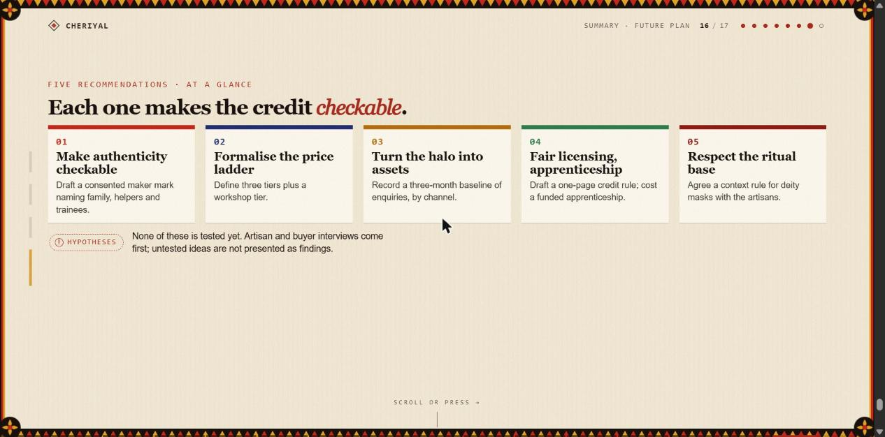
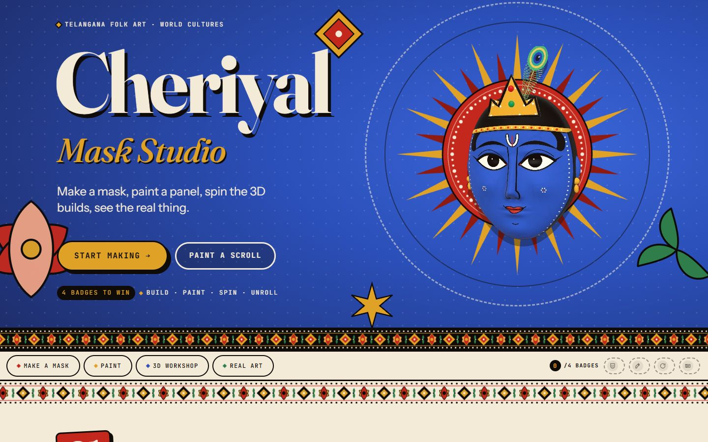

# Cheriyal: scrolls, masks and the people behind them

An interactive, scroll-driven presentation about **Cheriyal art**, a painted storytelling tradition from Telangana, India, plus a hands-on **Mask Studio** where you build, wear, print and share your own Cheriyal mask. It was made as a World Cultures project at SP Jain School of Global Management.

**Live presentation:** https://jaisnavbuildsrandomshit.github.io/cheriyal/
**Mask Studio (make your own mask):** https://jaisnavbuildsrandomshit.github.io/cheriyal/studio.html

## Preview

| The cultural iceberg | Diffusion of the craft |
| --- | --- |
|  |  |

## What is inside the presentation

- **Act I, The craft:** what Cheriyal is made of, and what its symbols say.
- **Act II, The people:** who holds the craft together, from families to patrons.
- **Act III, The market:** how the craft spreads, what buyers pay and what changes.
- **Act IV, The plan:** five hypotheses for making maker credit checkable.
- **Cultural iceberg:** what a buyer sees above the waterline, and the knowledge, skills and relationships below it.
- **Sources:** every fact on the slides links to its source.

The 3D masks are drawn live at your screen's full sharpness. A painted still shows first and stays on devices without 3D support.

## Mask Studio

- **Build a face:** start from Krishna, Hanuman, Rama, Sita, Ganesha, a demon, a villager or a tiger, with a short note on who each one is. Then change the face colour, crown, eyes, mouth, forehead mark and extras. Drag the mask (or use the arrow keys) to turn it, and undo or redo any change (Ctrl+Z, Ctrl+Shift+Z).
- **Try it on:** open your camera and the mask sits on your face, following you as you move, turn and tilt. Take a photo with your mask's name on it.
- **Print to wear:** get an A4 paper version with a cut line, eye holes and string holes. Print it on card, cut it out and wear it.
- **Share and keep:** every mask has its own link that opens it exactly as you made it. Keep up to 12 masks on your shelf. The studio also remembers your last mask in this browser.
- **Save as image:** a framed card of your mask, ready to post.
- **Paint a scroll panel**, spin and pull apart masks in the **3D workshop**, and follow links to **real Cheriyal masks** and how they are made.

## How it works

- The presentation and the studio are each **one HTML file** with their text, art, animation and scripts included. There is no build step and no account.
- Scroll, the arrow keys or swipe to move through the slides. Press **O** for the overview, **F** for fullscreen and **?** for all keyboard shortcuts. Links like `#s01` open a slide directly.
- Motion is reduced automatically when your system asks for it.
- The studio's **Try it on** button is the only part that loads anything from outside: Google's MediaPipe face tracker, downloaded from a CDN the first time you press it. The camera video stays on your device and is never uploaded.

## Honesty note

The research behind this presentation draws on published accounts, and some points are single sources. Market and buyer claims are hypotheses to test, not findings. Where a claim is an interpretation rather than evidence, the slides say so.

## Credits

Made by **Jaisnav Mohapatra**, undergraduate student, S P Jain Global.
