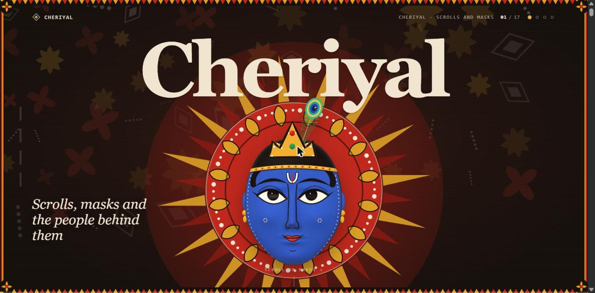
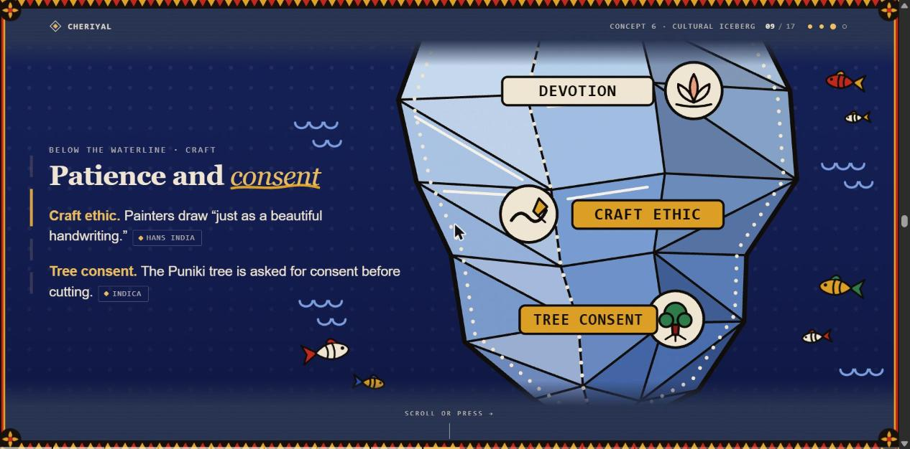
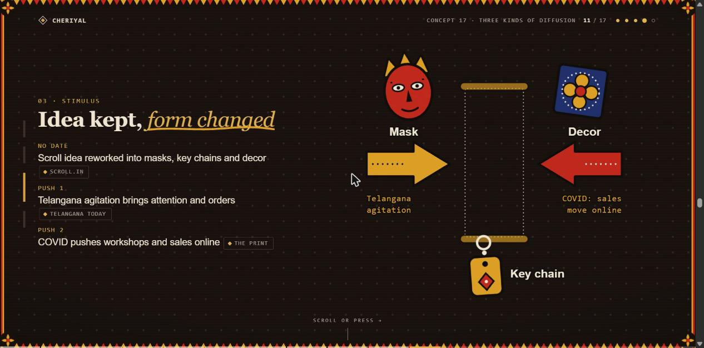

# Cheriyal: scrolls, masks and the people behind them

An interactive, scroll-driven presentation about **Cheriyal art**, a painted storytelling tradition from Telangana, India. It was made as a World Cultures project at SP Jain School of Global Management.

**Live presentation:** https://jaisnavbuildsrandomshit.github.io/cheriyal/
**Mask Studio (make your own mask):** https://jaisnavbuildsrandomshit.github.io/cheriyal/studio.html

## Preview

| The cultural iceberg | Diffusion of the craft |
| --- | --- |
|  |  |

## What is inside

- **Act I, The craft:** what Cheriyal is made of, and what its symbols say.
- **Act II, The people:** who holds the craft together, from families to patrons.
- **Act III, The market:** how the craft spreads, what buyers pay and what changes.
- **Act IV, The plan:** five hypotheses for making maker credit checkable.
- **Cultural iceberg:** what a buyer sees above the waterline, and the knowledge, skills and relationships below it.
- **Sources:** every fact on the slides links to its source.

## How it works

- The whole deck is **one HTML file**: text, art, animation and scripts are included, with no external services or accounts.
- Scroll, the arrow keys or swipe to move through the slides. Press **O** for the overview and **?** for all keyboard shortcuts.
- Motion is reduced automatically when your system asks for it.
- The Mask Studio's **Try it on** button uses your camera with Google's MediaPipe face tracker, downloaded from a CDN the first time you press it. The video stays on your device and is never uploaded.

## Honesty note

The research behind this presentation draws on published accounts, and some points are single sources. Market and buyer claims are hypotheses to test, not findings. Where a claim is an interpretation rather than evidence, the slides say so.

## Credits

Made by **Jaisnav Mohapatra**, undergraduate student, S P Jain Global.
